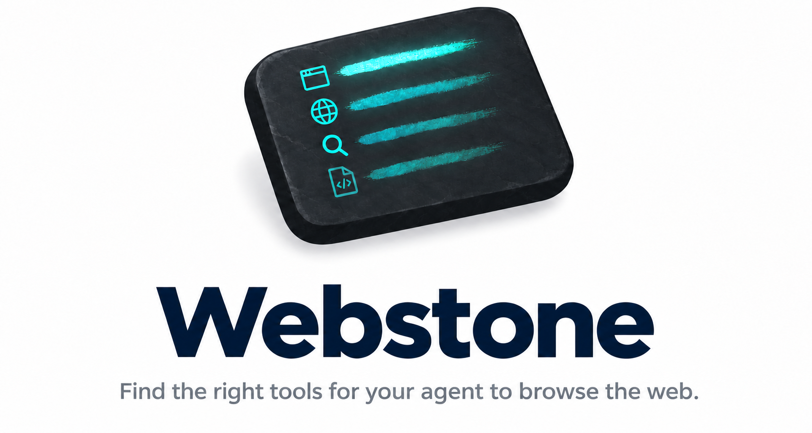

<div align="center">



[English](../README.md) · **简体中文**

[](https://github.com/lexmount/webstone/actions/workflows/ci.yml)
[](../LICENSE)
[](../pyproject.toml)

[快速开始](#快速开始) · [评测流程](#评测流程) · [提交结果](#提交结果) · [排行榜](https://webstone.dev.lexmount.net/)

</div>

Webstone 用于评测 AI Agent 使用的浏览器、搜索服务和网页提取工具，对比正确性、耗时、资源占用和已记录的成本。

- **要跑评测**：用 [Webstone 评测 Skill](../.agents/skills/webstone/SKILL.md) 选 Track、评测集和参评工具，准备环境、运行评测并按需生成报告。CLI 负责执行。
- **已有评测结果**：直接向 [webstone-site](https://github.com/lexmount/webstone-site) 提 PR。[投稿 Skill](https://github.com/lexmount/webstone-site/blob/main/.agents/skills/submit-webstone-result/SKILL.md) 会指引 Agent 整理数据。无需安装 Webstone CLI。

## 快速开始

在 Python 3.11 或更新版本的虚拟环境里安装 Webstone，再试跑离线示例。

```sh
pip install --upgrade webstone
webstone validate
webstone run --delay 0
```

打开终端打印的报告路径。示例预期一项通过、一项失败，无需浏览器、Docker 或 API 密钥。

给 Codex 安装评测 Skill。其他 Agent 可指定自己的 Skill 目录。

```sh
webstone skills install --directory "$HOME/.codex/skills"
```

想从源码安装，或当前版本没有 `skills` 命令，见[安装说明](agent-workflows.md#install)。

## 评测流程

| 流程 | 对应评测集与任务集 | 使用指南 |
| --- | --- | --- |
| Web Fetch | [LexBench-Web-Fetch](https://huggingface.co/datasets/Lexmount/LexBench-Web-Fetch)、[LexBench-WebMainBench](https://huggingface.co/datasets/Lexmount/LexBench-WebMainBench)、[LexBench-WCXB](https://huggingface.co/datasets/Lexmount/LexBench-WCXB) | [本地示例](../examples/web_fetch/README.md) · [完整指南](../src/harness/web_fetch/README.md) |
| Web Search | [LexBench-Web-Search](https://huggingface.co/datasets/Lexmount/LexBench-Web-Search) · [LexBench-SimpleQA-Verified](https://huggingface.co/datasets/Lexmount/LexBench-SimpleQA-Verified) 检索任务 | [本地示例](../examples/web_search/README.md) · [完整指南](../src/harness/web_search/README.md) |
| Web Extract | [Zyte Product Extraction](https://huggingface.co/datasets/Lexmount/LexBench-Zyte-Product-Extraction) · [SWDE](../examples/web_extract/README.md#swde-multi-domain-extraction) · [Expanded SWDE](https://huggingface.co/datasets/Lexmount/LexBench-Expanded-SWDE)、[NewsXLM](https://huggingface.co/datasets/Lexmount/LexBench-NewsXLM) 和 [LiveWeb-IE](https://huggingface.co/datasets/Lexmount/LexBench-LiveWeb-IE) | [网页结构化字段提取](../examples/web_extract/README.md) |
| Browser Trajectory Replay | [LexBench-Headless-Browser](https://huggingface.co/datasets/Lexmount/LexBench-Headless-Browser) 固定场景、[自建固定动作任务](https://huggingface.co/datasets/Lexmount/LexBench-Trajectory-Replay)使用显式断言；[WebArena Replay](https://huggingface.co/datasets/Lexmount/LexBench-WebArena-Replay)使用官方评测器 | [Headless 输入与上游运行器](https://huggingface.co/datasets/Lexmount/LexBench-Headless-Browser#execute-with-the-original-runner) · [自建任务集](../examples/trajectory_replay/README.md) · [WebArena Replay](../examples/trajectory_replay/public_webarena/README.md) |

实验性的 [Browser Use](../examples/browser_use/README.md) 由 Agent 自行决定浏览器操作，使用任务评测器检查最终结果。

[各 Track 的推荐流程](../.agents/skills/webstone/SKILL.md) · [评测设计](benchmarks.md#evaluation-design) · [报告指南](report-hosting.md)

## 提交结果

在 `webstone-site` 个人 fork 里新增一个结果版本，填入实测数据和公开证据，向上游提 PR。已有版本保留原样。格式、版本选择和提交后的上线核验见[投稿指南](https://github.com/lexmount/webstone-site/blob/main/docs/submitting-results.md)。

## 项目资料

[依赖和安装](dependencies.md) · [数据集与自定义任务](benchmarks.md) · [适配接口](provider-contract.md) · [架构](architecture.md) · [版本与发布](releases.md) · [贡献指南](../CONTRIBUTING.md) · [安全](../SECURITY.md) · [许可证](../LICENSE)

## 引用 Webstone

[CITATION.cff](../CITATION.cff)

```bibtex
@software{webstone_2026,
  author = {{Webstone contributors}},
  title = {Webstone: Benchmarking Browsers and Web Tools for AI Agents},
  note = {Evaluation harness},
  year = {2026},
  url = {https://github.com/lexmount/webstone}
}
```
