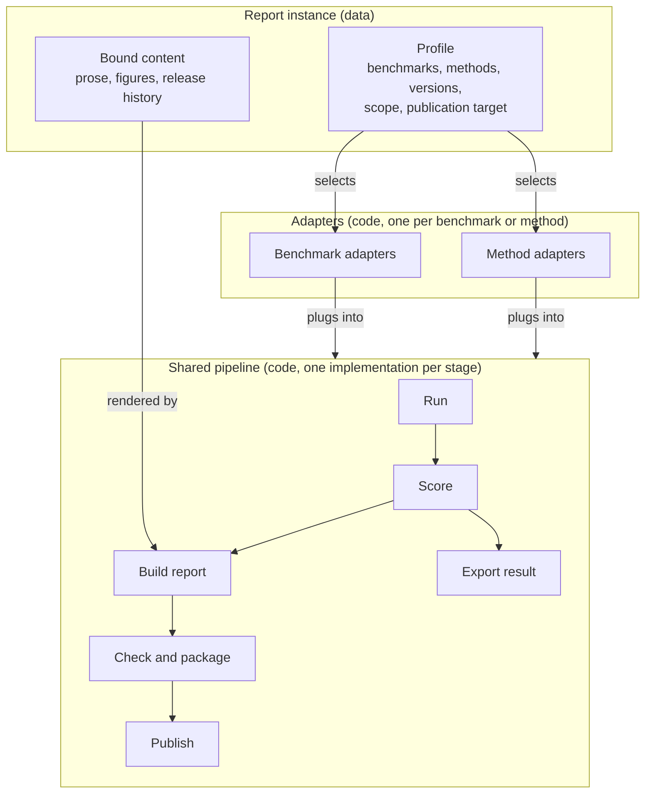
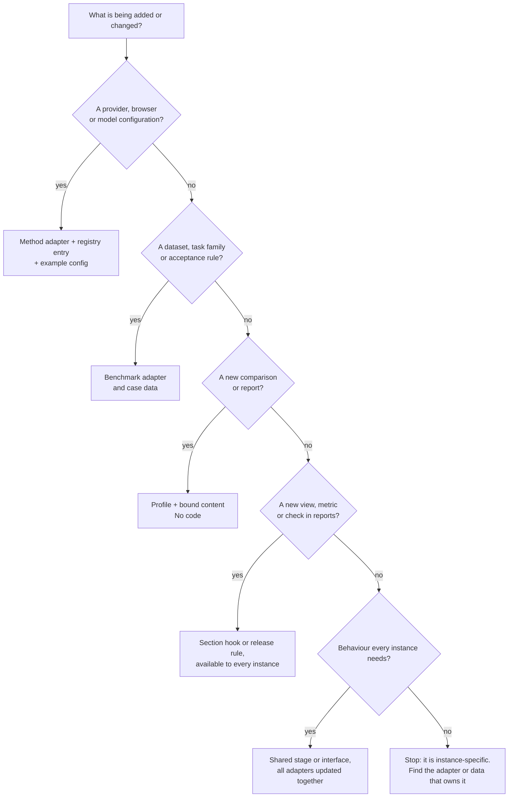

# Repository specification

This page is the standard that Webstone code, documentation and reviews follow.
[Architecture](architecture.md) says where the code is today; this page says what
must hold when it changes. The two agree on ownership, and where existing code
does not yet meet a rule here, [Migration](#migration) applies.

[Model](#model) · [Stages](#stages-and-artifacts) · [Extension points](#extension-points) · [Report instances](#report-instances) · [Commands](#command-surface) · [Rules](#rules) · [Where a change goes](#where-a-change-goes) · [Enforcement](#enforcement) · [Migration](#migration)

## Model

Webstone evaluates Web tools along one pipeline. An evaluation is a combination
of four things, and each of them is data or an adapter. None of them is a
branch in shared code.

| Term | Meaning | Examples |
| --- | --- | --- |
| Track | A kind of task with its own pipeline package | Web Fetch, Web Search, Web Extract, Browser Trajectory Replay, Browser Use |
| Benchmark | A task population with its inputs, references and acceptance rules | `content-scopes-530`, WCXB, WebMainBench, SimpleQA Verified, WebArena |
| Method | The thing being measured: a provider, a browser, or a model-by-browser configuration | a hosted fetch API, a browser engine, a Codex CLI mode |
| Report instance | One declared comparison: benchmarks × methods, their versions, scope and publication target | one published report |

The pipeline is shared. A new benchmark, method or report instance adds an
adapter and data. It does not add a runner, a renderer, a checker or a
conditional in a shared module.

**Figure 1. A report instance is data that selects adapters; the pipeline does not change.**



## Stages and artifacts

Stages communicate only through persisted artifacts. A stage reads the artifact
of the previous stage and writes its own. It never reaches into another stage's
memory, private files or code, so each stage can be rerun or replaced alone.

**Figure 2. Stages and the artifacts they exchange.**

```mermaid
flowchart LR
    PR[/"Profile"/] --> I["Prepare inputs"]
    I --> DS[/"Frozen dataset<br/>cases, references, hashes"/]
    DS --> R["Run"]
    R --> CR[/"Call records<br/>one per physical call,<br/>plus raw evidence"/]
    CR --> S["Score"]
    DS --> S
    S --> SR[/"Scored results<br/>one logical result per<br/>method and task"/]
    SR --> B["Build report"]
    RC[/"Bound report content"/] --> B
    B --> RD[/"Report directory<br/>report model and rendered pages"/]
    RD --> K["Check and package"]
    K --> PK[/"Package<br/>archive, inventory, receipts"/]
    PK --> PB["Publish to Yours<br/>(optional share)"]
    PB --> RCPT[/"Publication receipt"/]
    SR --> X["Export result"]
    RCPT -.-> X
    X --> RJ[/"Result submission"/]
    RJ --> U["Submit to webstone-site"]
```



| Stage | Reads | Writes | Shared owner | Must not |
| --- | --- | --- | --- | --- |
| Prepare inputs | Profile, data lock | Frozen dataset | `src/harness/benchmarks/` and the benchmark adapter | Read measured outputs |
| Run | Frozen dataset, method adapters | Call records and raw evidence | `src/harness/benchmark_execution.py` and the track runner | Score, or drop a physical call |
| Score | Call records, frozen dataset | Scored results | The benchmark's scorer (`src/lexbench_*` or the pinned upstream evaluator) | Call a method, or select rules by method name |
| Build report | Scored results, bound content | Report directory | `src/harness/reporting/` and the track's report module | Call a method, rescore, or embed instance content |
| Check and package | Report directory | Package | `src/harness/reporting/` | Change scores or evidence |
| Publish | Package, publication target | Publication receipt | `src/harness/reporting/publish.py` | Rebuild the report |
| Export result | Scored results, receipt | Result submission | `src/harness/results/` | Require hand-entered measurements |

Every artifact has a named, versioned schema, and the stage that reads it
validates it. A reader can therefore take an artifact produced on another
machine, by another person, and continue from that point.

## Extension points

These are the only places where code specific to one method, benchmark or track
may live. When an adapter cannot express what an instance needs, extend the
interface for every adapter in the same change; do not branch around it.

| Extension point | Declares | Added when |
| --- | --- | --- |
| Method adapter | Identity and version, capabilities, how to make one call, how to turn its native output into the track's call record, failure classification, cost | A provider, browser or model configuration is added |
| Benchmark adapter | How to load and serve cases, the scorer, populations and denominators, metric set, expected counts, review prompts | A dataset or task family is added |
| Environment adapter | How to deploy, reset, log in to and label a site or runtime | A stateful target (for example a WebArena site) is added |
| Track registration | The track's stage implementations, schemas and example, keyed by the fixed stage names | A track is added |
| Report section hook | A section or detail view that a benchmark or track contributes to the report model | A report needs a view the shared sections do not have |
| Release rule | An additional check a track contributes to the shared release gate | A track has a presentation or evidence rule of its own |
| Publication target | Host, site, expected version, visibility and share setting | A report instance is published |
| Result exporter | How a track's scored results map to a result submission | A track's results go to webstone-site |

Adapters register themselves in one registry per extension point. Shared code
obtains them from the registry, and command choices, validation sets and tests
derive from the registry too. A hardcoded list of adapter names anywhere else is
a second registry and is not allowed.

The shapes below fix the responsibilities. Field names converge as tracks
migrate; the split of responsibilities does not.

```python
class MethodAdapter(Protocol):
    name: str
    capabilities: Capabilities            # declared, never inferred from the name

    def identity(self) -> MethodIdentity: ...          # version, binary hash, settings
    def preflight(self, cases) -> list[str]: ...       # missing requirements
    def call(self, case, deadline) -> CallRecord: ...  # one physical call, raw evidence kept
    def project(self, raw) -> ScoredInput: ...         # native output -> what the scorer reads


class BenchmarkAdapter(Protocol):
    name: str

    def cases(self, lock) -> Iterable[Case]: ...
    def score(self, case, scored_input) -> Score: ...  # task rules come from case data
    def populations(self) -> list[Population]: ...     # denominators, families, metric sets


class TrackStages(Protocol):          # fixed keys; a track supplies each or declares it absent
    run: Stage; score: Stage; report: Stage; check: Stage
    package: Stage; publish: Stage; export: Stage
```

## Report instances

A report instance is described entirely by data: a **profile** and its **bound
content**.

- The profile names the benchmarks, methods, exact versions, scope, expected
  counts, publication target and language. It lives beside the external
  evidence and is passed explicitly to each stage.
- Bound content holds everything written for that one report: interpretation
  prose, figures, labels that differ from the catalog, release history, dated
  notes and any sentence that quotes a measured value, in every language the
  report ships.
- Shared code holds none of this. A renderer, checker, translation map or
  message catalog must not contain a method's measured numbers, a benchmark's
  size, a version string, a campaign name or prose about one report.

Combining results is a pipeline operation. Separately produced run directories
for the same frozen dataset combine into one comparison through a documented
command that discovers the runs, verifies their hashes and writes the build
input. Any file a stage needs is either committed data or produced by a
documented command; a stage must not depend on a file that someone writes by
hand with computed hashes.

Customisation remains possible and expected. It goes into the profile, the bound
content or an adapter, never into the stage.

## Command surface

Every track exposes the same stage verbs through one root command, and every
verb takes the profile or the previous stage's artifact:

```text
webstone <track> run | score | report | check | package | publish | export
```

A track may omit a stage it does not have and may add preparation commands of
its own. It may not offer a second command for a stage that already has a verb,
nor a benchmark-specific variant of a verb. Mode selection comes from the
profile. Files under `scripts/` and Make targets stay thin wrappers over these
verbs.

Another person must be able to reproduce an evaluation from a clean checkout,
their own credentials and the documented commands alone: prepare inputs, run,
score, build the report, and optionally publish. Nothing may depend on the
author's working session.

## Rules

1. **No instance in shared code.** Shared modules do not name a method, benchmark,
   site, dataset size, version, campaign or report. They read capabilities and
   declarations from adapters and profiles.
2. **Dependencies point inward.** Shared packages import no track. A track imports
   shared packages and its own adapters, not another track. Adapters import the
   interface they implement.
3. **One implementation per stage.** A track has one runner, one scorer entry, one
   report builder, one release gate and one publisher. A second benchmark or
   method reuses them through an adapter.
4. **Artifacts are the only coupling.** Stage inputs and outputs are persisted,
   schema-versioned and validated on read. No stage passes state through
   globals, context variables or undeclared keys.
5. **Inputs are generated or committed.** No stage needs a hand-authored file with
   computed hashes, enumerated case identifiers or copied identifiers.
6. **Interfaces are explicit.** Every hook that shared code calls is declared on
   the interface. Shared code does not probe adapters with `getattr` or by type
   name.
7. **Extend the interface, not the caller.** When an instance does not fit, change
   the interface for all adapters. A conditional on one adapter's name in shared
   code is the signal that an interface is missing.
8. **Instance content is bound data.** Prose, numbers and labels for one report
   live in its bound content and are rendered from there in each language.
9. **Reproduction is a command sequence.** The documented commands, a clean
   checkout and credentials are sufficient.
10. **History stays verifiable.** Frozen evidence, published reports and
    hash-bound sources named by a current authority keep their bytes. Rules 1–8
    govern current code paths, and historical bytes are data read through them.

## Where a change goes

**Figure 3. Deciding where a change belongs.**



| Change | Expected to touch | Not expected to touch |
| --- | --- | --- |
| Add a method | One adapter module, its registry entry, example config, pricing or catalog data, its tests | Runner, scorer, projection or routing code shared by other methods, renderer, checker |
| Add a benchmark | One benchmark adapter, data lock entry, case data, its tests | Runner loop, certifier, CLI dispatch, renderer |
| Add a report instance | Profile and bound content outside Git | Any file under `src/` |
| Add a track | A track package implementing the stage registration, an example, tests | Other tracks, shared packages except their registries |
| Add a report view | A section hook and its release rule | A branch on benchmark or method in the renderer |

A diff that falls in the right-hand column is either an interface extension,
which the description must state and justify for all adapters, or a violation.

## Enforcement

Reviews apply this page to every change. Three mechanical checks back them up:

- **Layering check.** A test fails when a shared package imports a track, or a
  track imports another track.
- **Instance-literal check.** A test fails when a shared module names a registered
  method, benchmark or site, or matches a measured-value pattern in a renderer,
  checker or translation map. Existing occurrences are listed in an allowlist
  that may only shrink.
- **Conformance example.** Each track runs a synthetic method and a synthetic
  benchmark, registered only through adapters, through every stage it supports.
  This proves that an instance can be added without editing shared code.

## Migration

Existing code predates this page. New code and every touched code path conform
from now on. Existing violations are recorded in the allowlists above and
removed by tracked tasks. A migration preserves frozen evidence and published
reports, moves callers atomically, and removes the code it replaces in the same
change.
